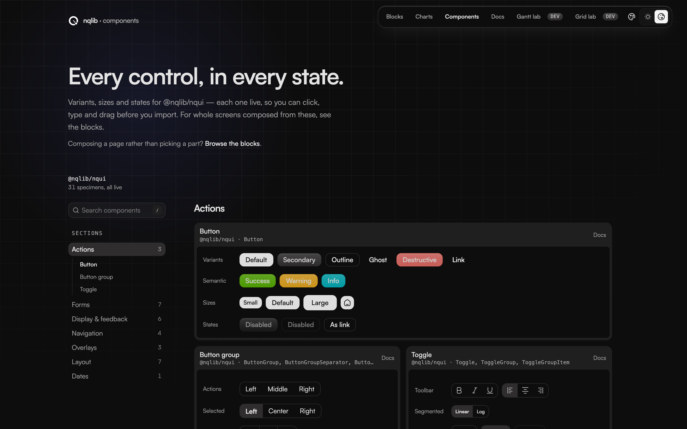

# @nqlib/nqui

<p align="center">
  
</p>

React components for product UI. Buttons, forms, overlays, and scroll, themed with your tokens.

## Use

```bash
npm install @nqlib/nqui
```

```tsx
import { Button } from "@nqlib/nqui"
import "@nqlib/nqui/styles"
```

Examples, props, and the catalog: [nqlib.com/docs/nqui](https://nqlib.com/docs/nqui)
